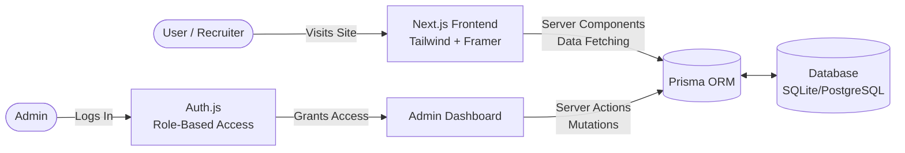

<div align="center">
  <h1>🚀 Muhammad Azeem | Developer Portfolio & CMS</h1>
  <p><strong>Custom full-stack portfolio and CMS built to showcase AI and business automation solutions.</strong></p>
  <p>
    <a href="https://www.muhammadazeemzahid.com">Live Site</a> • 
    <a href="https://www.linkedin.com/in/muhammad-azeem-zahid-0936313b4/">LinkedIn</a> • 
    <a href="mailto:muhammadazeemzahid1@gmail.com">Contact</a>
  </p>
</div>

<br />

## 👨‍💻 About Me

I am an **AI Automation Engineer & Full-Stack Developer** helping international business owners and startup founders automate workflows and reduce operational costs. 

My primary expertise lies in:
- **AI & Automation:** n8n, OpenAI, Python
- **Backend Development:** Django, Node.js, PostgreSQL, REST APIs
- **Frontend Development:** Next.js (App Router), React, Tailwind CSS

*Tagline:* **Automate the Work. Accelerate the Business.**

---

## 🏗️ Project Overview

This repository houses the source code for my personal portfolio. Rather than using a generic template or a no-code website builder, I engineered a custom **Full-Stack Next.js Application** with a bespoke integrated CMS.

### 🌟 Key Features

- **Custom Content Management System (CMS):** A secure admin panel to manage Case Studies, Services, and Testimonials without writing code.
- **Role-Based Authentication:** Powered by Auth.js (NextAuth) protecting admin routes.
- **Server-Side Rendering & SEO:** Fully optimized Next.js App Router setup with dynamic `generateMetadata` for top-tier SEO and performance.
- **Responsive & Animated UI:** Built with Tailwind CSS v4 and Framer Motion for a premium user experience.

---

## 🛠️ Tech Stack

| Category | Technologies |
|---|---|
| **Framework** | Next.js (React 19) |
| **Styling & UI** | Tailwind CSS v4, Framer Motion, Lucide React |
| **Database & ORM** | SQLite (Dev) / PostgreSQL (Prod), Prisma ORM |
| **Authentication** | NextAuth.js (Auth.js) + bcryptjs |
| **Integrations** | React Calendly, Resend (Email), Zod |
| **Language** | TypeScript |

---

## 🗺️ Architecture



---

## 🚀 Getting Started

To run this project locally, follow these steps:

### 1. Clone & Install

```bash
git clone https://github.com/Muhammad-azeem11/muhammadazeem-portfolio.git
cd muhammadazeem-portfolio
npm install
```

### 2. Environment Variables

Create a `.env` or `.env.local` file by copying the template:

```bash
cp .env.local.example .env.local
```

Ensure you set a generated `AUTH_SECRET` for NextAuth to work locally (e.g. `openssl rand -base64 32`).

### 3. Database Setup

Initialize the SQLite database and run Prisma migrations:

```bash
npx prisma generate
npx prisma db push
```

*(Optional)* Seed the database with sample case studies:
```bash
npx tsx seed_cases.ts
```

### 4. Run the Development Server

```bash
npm run dev
```

Open [http://localhost:3000](http://localhost:3000) to view the application.

---

## 📂 Project Structure

```text
src/
├── app/             # Next.js App Router (Pages & API Routes)
│   ├── (admin)/     # Protected CMS routes
│   ├── (marketing)/ # Public portfolio pages
│   └── actions/     # Next.js Server Actions for DB mutations
├── components/      # Reusable React components (Sections, UI)
├── config/          # Centralized configuration (Site info, SEO)
├── hooks/           # Custom React hooks
├── lib/             # Utility functions, Prisma client setup
└── types/           # TypeScript type definitions
```

---

<div align="center">
  <p><i>Designed and engineered by Muhammad Azeem.</i></p>
</div>
